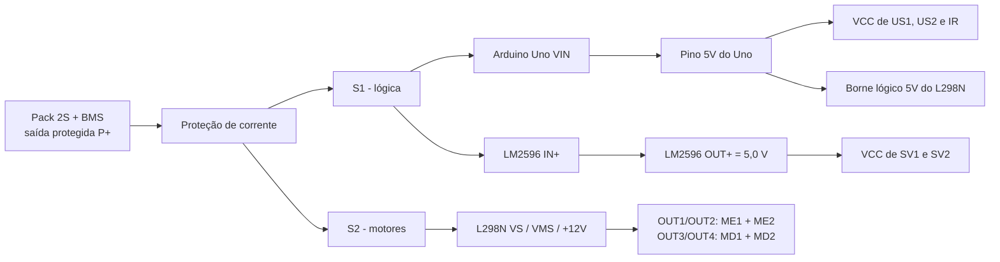

# Distribuição de energia, BMS e jumpers

Seções 3, 4 e 5 do manual.

## Ramos de alimentação

A saída protegida do pack (P+ e P-) alimenta dois ramos: **S1** para a lógica e **S2** para os
motores. Os servos recebem os 5 V do LM2596; os sensores e a lógica do L298N recebem os 5 V do
Arduino.

### Retorno e referência comum

- O ponto comum de retorno fica na saída protegida **P-** do BMS.
- Do P- derivam os retornos do L298N, do LM2596 e do Arduino.
- GND dos sensores e retornos dos servos pertencem à mesma referência.
- A corrente dos motores **não** deve passar pelos contatos da protoboard nem pelos GND dos sensores.

### Não unir as duas saídas de 5 V

O 5V do Arduino e o OUT+ do LM2596 alimentam grupos diferentes. O único ponto compartilhado entre
eles é o GND. Ligar reguladores em paralelo não faz parte deste projeto.

## BMS e pack 2S

2S = duas células em série. Para células de 3,7 V nominais o pack é de 7,4 V e chega a 8,4 V se
cada célula admitir carga até 4,2 V. Esses valores dependem da química real (ver
[ficha da célula](../datasheet/componentes/celula_18650.md)).

| Terminal usual | Ligação ou função |
|---|---|
| B- | Extremidade negativa do conjunto de células |
| BM ou B1 | Junção entre o positivo da primeira célula e o negativo da segunda |
| B+ | Extremidade positiva do conjunto de células |
| P+ e P- | Saída protegida destinada à distribuição de energia do carrinho |
| C- (quando presente) | Porta de carga separada em alguns modelos; seguir o manual da placa |

- A tabela indica funções usuais, **não** a posição física dos pads.
- A junção BM é ponto de supervisão das células: **não** alimentar nenhuma parte do carrinho por ela.
- Ligar carga direto em B- pode contornar a proteção. Usar a saída protegida.
- Sequência de conexão, ativação e balanceamento: seguir o fabricante do BMS escolhido.
- O BMS não é carregador: usar carregador apropriado à química e ao arranjo 2S.

## Jumpers do L298N

| Jumper | Posição neste esquema | Finalidade |
|---|---|---|
| ENA | Removido | Permitir PWM do Arduino no pino 3 |
| ENB | Removido | Permitir PWM do Arduino no pino 11 |
| 5V-EN | Removido (lógica externa) | Receber 5 V do Arduino no borne lógico 5V do módulo |

- Confirmar na placa real a função de cada jumper e borne antes de ligar. Nunca usar a posição de
  um desenho genérico para identificar +5V, GND ou a entrada dos motores.
- O borne de potência pode estar marcado como VS, VMS ou **+12V**. Essa marcação identifica o
  terminal; não indica a tensão a aplicar.

## Ajuste do LM2596

1. Servos **desconectados** e S2 aberta.
2. Alimentar só o ramo S1 e medir OUT+ em relação a OUT-.
3. Ajustar para **5,0 V**, desde que compatível com os servos (confirmar na
   [ficha do servo](../datasheet/componentes/servomotor.md)).
4. Desligar a alimentação e só então conectar os servos.
5. Repetir a medição com os servos em movimento e sustentando carga.

## Alimentação do Uno

- O Uno é alimentado por **VIN**; a faixa recomendada é **7 a 12 V**.
- Medir VIN durante a partida dos motores. A descarga do pack 2S reduz a margem.
- Interromper os ensaios se a alimentação sair da condição admissível ou se a placa reiniciar.
- **Não** aplicar os 5 V do LM2596 no VIN.
