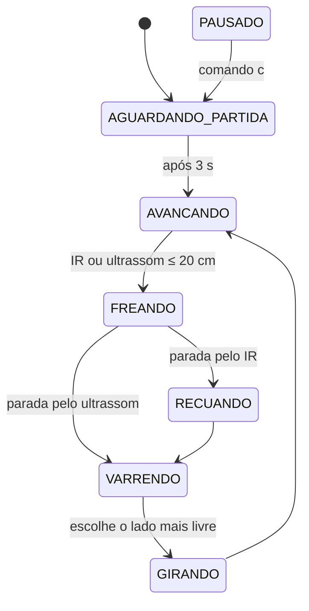

# Equipe de Programação

**Integrantes:** Luiz, Gabriel, Guilherme, Erick

Responsável pelo firmware do carrinho. O programa de teste do manual (Apêndice A) serve apenas
para conferir conexões: ele repete ciclos fixos de 2 s, não reavalia o IR durante os `delay` e não
faz varredura, desvio ou parada por obstáculo. O [carrinho_autonomo](firmware/carrinho_autonomo/)
implementa essas funções, que o manual exige antes do uso autônomo (seção 10).

## Módulos

| Arquivo | Conteúdo |
|---|---|
| [carrinho_autonomo.ino](firmware/carrinho_autonomo/carrinho_autonomo.ino) | Máquina de estados, parada de emergência pelo IR, comandos e telemetria serial |
| [config.h](firmware/carrinho_autonomo/config.h) | Pinagem, convenções e todos os parâmetros de calibração |
| [motores.h](firmware/carrinho_autonomo/motores.h) / [.cpp](firmware/carrinho_autonomo/motores.cpp) | Acionamento por lado, roda livre e frenagem ativa no L298N |
| [sensores.h](firmware/carrinho_autonomo/sensores.h) / [.cpp](firmware/carrinho_autonomo/sensores.cpp) | Ultrassônicos alternados, mediana para varredura e leitura do IR |
| [servos.h](firmware/carrinho_autonomo/servos.h) / [.cpp](firmware/carrinho_autonomo/servos.cpp) | Centralização e posição de varredura de SV1 e SV2 |

A divisão das tarefas entre os integrantes fica em [docs/equipes.md](../docs/equipes.md).

## Funcionamento



O comando `p` leva qualquer estado para PAUSADO.

- **Avanço.** US1 e US2 ficam frontais e são lidos alternadamente (um disparo a cada 35 ms). Com
  obstáculo até 45 cm, ou sem leitura válida em algum sensor, o PWM cai para a velocidade de
  cautela. Até 20 cm, o carrinho freia.
- **Emergência pelo IR.** D2 é a interrupção INT0. Quando o IR indica obstáculo, a interrupção freia
  os motores na hora, mesmo no meio de uma leitura de ultrassom, e bloqueia novos comandos de avanço.
  Ré e giro continuam permitidos. O bloqueio só é liberado ao voltar para AVANCANDO com o IR livre.
- **Frenagem.** `motoresFrear()` coloca ENA/ENB em HIGH com as entradas iguais ("fast motor stop"
  do L298). `motoresParar()` é a parada por roda livre do programa de teste.
- **Varredura.** SV1 vira para a esquerda e SV2 para a direita. Cada lado é medido pela mediana de
  três leituras e o carrinho gira para o lado mais livre. Com os dois lados bloqueados, faz meia-volta.
- **Leitura zero.** Distância 0 significa sem leitura válida (sem eco, timeout ou fora da faixa de
  2 a 400 cm), nunca distância física (seção 10 do manual).

Comandos no monitor serial (9600 baud): `p` pausa, `c` continua, `?` mostra o estado. A telemetria
sai a cada 500 ms, por exemplo:

```
AVANCANDO | IR: Livre | US1: 87 cm | US2: 64 cm | E: 150 D: 150
```

## Calibração (config.h)

Ajustar com os resultados repassados pela Montagem e pela Datasheet:

| Parâmetro | De onde vem |
|---|---|
| `IR_NIVEL_OBSTACULO` | T03 e caracterização do IR (Datasheet) |
| `INVERTER_LADO_ESQUERDO` / `_DIREITO` | T06 (sentido de cada lado) |
| `ANGULO_OLHAR_ESQUERDA` / `_DIREITA` | T04 (curso seguro e lado para onde cada servo gira) |
| `AJUSTE_PWM_ESQUERDO` / `_DIREITO` | T08: carrinho desviando em linha reta |
| `TEMPO_GIRO_90_MS` / `_180_MS` | T08: medir no piso de operação |
| `DISTANCIA_PARADA_CM` / `_CAUTELA_CM` | T08: distância de frenagem real |
| `VELOCIDADE_*` | T06 e T08: torque suficiente sem aquecer o L298N |

Atualizar `VERSAO_FIRMWARE` a cada mudança carregada no carrinho e informar a versão à Montagem
para o Apêndice B.

## Como carregar

1. IDE do Arduino 2.x: **Arquivo → Abrir** e escolher `carrinho_autonomo.ino`. Os outros arquivos
   da pasta abrem como abas.
2. **Ferramentas → Placa → Arduino Uno** e a porta correspondente.
3. **S2 desligada** durante o upload.
4. Primeiro teste com o chassi suspenso: aproximar a mão do IR e de cada ultrassônico e conferir
   FREANDO / RECUANDO / VARRENDO / GIRANDO na telemetria.

## Antes do piso (T08)

- [ ] T01 a T07 aprovados e registrados pela Montagem
- [ ] Nível do IR confirmado; frenagem pelo IR testada com o chassi suspenso
- [ ] Ângulos de varredura dentro dos limites aprovados no T04
- [ ] Sentido de giro conferido (`<` e `>` no bancada_motores)
- [ ] Área livre e alguém pronto para desligar S2

## Simulação

O registro dos testes no Tinkercad e os limites da cópia com dois motores estão em
[simulacao_tinkercad.md](simulacao_tinkercad.md).
