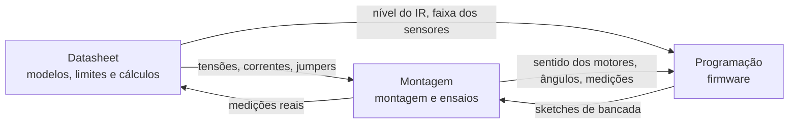

# Equipes do projeto

O trabalho segue o manual ROB4M MT 001 Rev. 1.0. Cada equipe tem uma pasta própria no
repositório; as tabelas de tarefas têm a coluna **Responsável** em branco para a própria equipe
distribuir as atividades entre os integrantes.

## Montagem

**Integrantes:** Kauan, Caio, Pedro, Kelvin, Eduardo, Erick Kelvin
**Pasta:** [montagem/](../montagem/)

| Tarefa | Seção do manual | Documento | Responsável |
|---|---|---|---|
| Conferir componentes e instrumentos | 2 | [01_lista_de_materiais.md](../montagem/01_lista_de_materiais.md) | |
| Montar a distribuição de energia, BMS e jumpers | 3, 4 e 5 | [02_distribuicao_de_energia.md](../montagem/02_distribuicao_de_energia.md) | |
| Fixar motores, módulos, servos e sensores no chassi | 8 | [03_montagem_mecanica.md](../montagem/03_montagem_mecanica.md) | |
| Montagem elétrica, etapas 1 a 7 | 6, 7 e 9 | [04_montagem_eletrica.md](../montagem/04_montagem_eletrica.md) | |
| Etiquetar e organizar os chicotes | 2 e 8 | [05_chicotes_e_etiquetas.md](../montagem/05_chicotes_e_etiquetas.md) | |
| Executar os ensaios T01 a T08 | 11 | [06_ensaios_de_bancada.md](../montagem/06_ensaios_de_bancada.md) | |
| Registrar medições e intervenções (Apêndice B) | Apêndice B | [registros/](../montagem/registros/) | |
| Diagnóstico de falhas e manutenção | 13 | [07_diagnostico_e_manutencao.md](../montagem/07_diagnostico_e_manutencao.md) | |

**Entrega para Programação:** inversões de fios feitas, sentido de giro de cada lado, ângulos
seguros dos servos (T04), lado para onde cada servo gira e medições de tensão durante as partidas.

## Programação

**Integrantes:** Luiz, Gabriel, Guilherme, Erick
**Pasta:** [programacao/](../programacao/)

| Tarefa | Arquivo | Responsável |
|---|---|---|
| Acionamento dos motores e frenagem | [motores.cpp](../programacao/firmware/carrinho_autonomo/motores.cpp) | |
| Leitura dos ultrassônicos e do IR | [sensores.cpp](../programacao/firmware/carrinho_autonomo/sensores.cpp) | |
| Servos e varredura | [servos.cpp](../programacao/firmware/carrinho_autonomo/servos.cpp) | |
| Máquina de estados e parada de emergência | [carrinho_autonomo.ino](../programacao/firmware/carrinho_autonomo/carrinho_autonomo.ino) | |
| Calibração dos parâmetros com os resultados da bancada | [config.h](../programacao/firmware/carrinho_autonomo/config.h) | |
| Manutenção dos sketches de bancada usados pela Montagem | [montagem/firmware/](../montagem/firmware/) | |
| Simulação no Tinkercad | [simulacao_tinkercad.md](../programacao/simulacao_tinkercad.md) | |

**Entrega para Montagem:** sketches de bancada prontos para cada ensaio e a versão do programa a
anotar no Apêndice B.

## Datasheet

**Integrantes:** Dimitri, Andrey, Luan, Pedro Henrique, Israel
**Pasta:** [datasheet/](../datasheet/)

| Tarefa | Documento | Responsável |
|---|---|---|
| Arduino Uno R3 | [arduino_uno_r3.md](../datasheet/componentes/arduino_uno_r3.md) | |
| Ponte H L298N | [l298n.md](../datasheet/componentes/l298n.md) | |
| Conversor LM2596 | [lm2596.md](../datasheet/componentes/lm2596.md) | |
| Ultrassônico HC-SR04 | [hc_sr04.md](../datasheet/componentes/hc_sr04.md) | |
| Servomotores | [servomotor.md](../datasheet/componentes/servomotor.md) | |
| Sensor IR | [sensor_ir.md](../datasheet/componentes/sensor_ir.md) | |
| Motores CC | [motor_cc.md](../datasheet/componentes/motor_cc.md) | |
| BMS 2S | [bms_2s.md](../datasheet/componentes/bms_2s.md) | |
| Células 18650 | [celula_18650.md](../datasheet/componentes/celula_18650.md) | |
| Dimensionamento elétrico | [dimensionamento.md](../datasheet/dimensionamento.md) | |
| Caracterização dos sensores | [caracterizacao_sensores.ino](../datasheet/firmware/caracterizacao_sensores/caracterizacao_sensores.ino) | |
| Referências técnicas | [referencias.md](../datasheet/referencias.md) | |

**Entrega para Montagem:** tensões admissíveis, corrente dos motores por canal, posição dos jumpers
do módulo real, sequência de ligação do BMS e carregador compatível.

**Entrega para Programação:** nível ativo do IR, faixa útil e dispersão dos ultrassônicos, curso
admissível dos servos.

## Como as equipes se conectam

A Montagem também devolve à Datasheet as medições reais (corrente dos pares, tensão sob carga,
aquecimento), que substituem as estimativas do [dimensionamento](../datasheet/dimensionamento.md).
